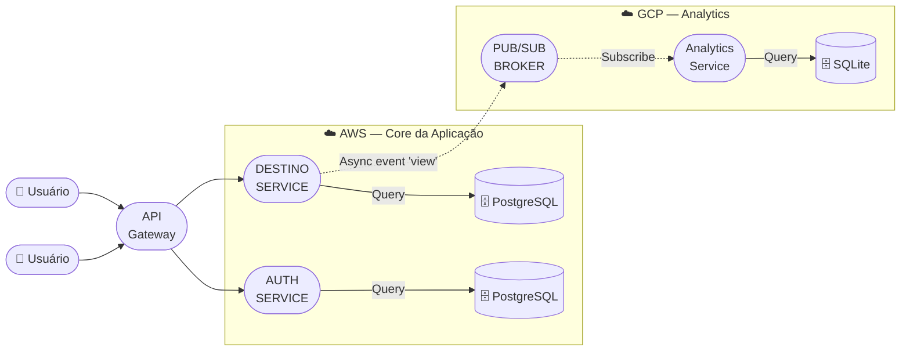
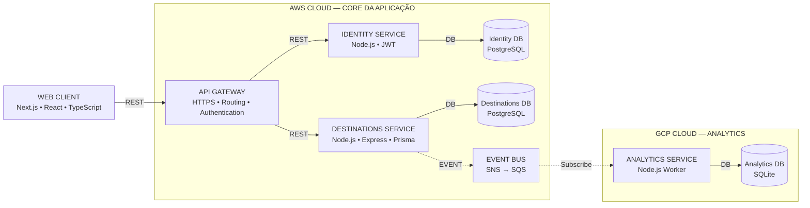

# 🌵 Rotas Nordestinas

Plataforma digital para promoção do turismo sustentável e valorização cultural no Nordeste do Brasil.

**Projeto:** Rotas Nordestinas — Plataforma de Turismo no Nordeste Brasileiro
**Instituição:** Universidade Federal do Piauí (UFPI) — 2026.2
**Docente:** Profª Dra. Juliana Oliveira de Carvalho

---

## 💡 Sobre o Projeto

O **Rotas Nordestinas** é uma plataforma web que reúne **rotas turísticas, culturais e gastronômicas** do Nordeste brasileiro. Seu objetivo é facilitar o acesso de turistas e moradores a informações sobre **locais, eventos e serviços regionais**, valorizando a cultura local e promovendo o **turismo sustentável**.

### Funcionalidades

| Funcionalidade | Descrição |
|---------------|-----------|
| 🏙️ **Explorar Cidades** | Ver todas as cidades do Nordeste com fotos, descrições e coordenadas no mapa |
| 📍 **Pontos Turísticos** | Descobrir praias, museus, parques e atrações de cada cidade |
| ✈️ **Como Chegar** | Ver opções de transporte (terrestre, aéreo, marítimo) |
| 🎯 **Atividades** | Conhecer atividades disponíveis: trilhas, passeios, festas |
| 💡 **Dicas** | Receber dicas de viagem: melhor época, o que levar |
| 💬 **Comentários** | Compartilhar experiências e ler feedbacks |
| ❤️ **Favoritos** | Salvar cidades favoritas |
| 🗺️ **Mapa Interativo** | Visualizar destinos usando Leaflet |
| ✍️ **Sugerir Rota** | Enviar sugestões de novas cidades |

---

## 🏗️ Arquitetura

O sistema é uma **arquitetura em microsserviços** com 3 serviços independentes, expostos por um **API Gateway** e desacoplados por um **barramento de eventos**. Os dois diagramas abaixo explicam a aplicação: o primeiro mostra o **fluxo lógico de requisições e eventos**; o segundo, a **visão de deploy multi-cloud**.

### 1️⃣ Visão Lógica — Fluxo de Requisições e Eventos



**Como a aplicação funciona neste fluxo:**

1. **Entrada única:** todos os usuários passam pelo **API Gateway**, responsável por HTTPS, roteamento e autenticação.
2. **Conteúdo turístico (síncrono):** o gateway roteia para o **Destino Service**, que consulta seu PostgreSQL isolado e devolve cidades, pontos turísticos, como chegar, atividades, dicas, comentários e favoritos.
3. **Identidade (síncrona):** cadastro, login e perfil passam pelo **Auth Service**, que consulta seu próprio PostgreSQL e emite tokens **JWT**.
4. **Telemetria (assíncrona):** quando um usuário visualiza um destino, o Destino Service publica o evento `"view"` no **Pub/Sub Broker** e responde ao usuário sem esperar. O **Analytics Service** (GCP) assina o tópico, consome o evento em background e grava as métricas no **SQLite** — a navegação nunca bloqueia por causa de analytics.

### 2️⃣ Visão Multi-cloud — Deploy AWS + GCP



**Correspondência com os microsserviços do projeto:**

| Diagrama | Microsserviço do projeto | Provedor |
|----------|--------------------------|----------|
| Identity Service | **Portal & Auth** | AWS |
| Destinations Service | **Destinos Core** | AWS |
| Analytics Service | **Analytics & Notification** | GCP |

**Legenda:**

| Símbolo | Significado |
|---------|-------------|
| ➡️ `REST` | Comunicação **síncrona** (resposta imediata) |
| ⤍ `EVENT` | Comunicação **assíncrona** (evento desacoplado) |
| 🗄️ `DB` | **Persistência isolada** (database-per-service) |

### 📐 Princípios Arquiteturais

- **Decomposição por domínio de negócio** (bounded contexts)
- **Baixo acoplamento** entre serviços
- **Database-per-Service** — nenhum banco é compartilhado
- **REST** para operações síncronas
- **Eventos** (`DestinationViewed`, comentários, favoritos) para processamento assíncrono
- **AWS / GCP** para o experimento multi-cloud

### Os 3 Microsserviços

| Microsserviço | Responsabilidade | Tecnologia | Provedor |
|---------------|------------------|------------|----------|
| **Portal & Auth** | Frontend + Identidade | Next.js / JWT | AWS |
| **Destinos Core** | Conteúdo Turístico | Express / Prisma | AWS |
| **Analytics** | Métricas + Notificações | Node.js / SQLite | GCP |

---

## 📚 Documentação

A documentação completa está organizada na pasta `docs/`:

```
docs/
├── README.md                    # Índice principal
├── architecture/                # Arquitetura do sistema
│   ├── README.md               # Visão geral
│   ├── bounded-contexts.md     # Decomposição em microsserviços
│   ├── communication-patterns.md
│   └── monolith-to-microservices.md
├── master/                      # Pós-Graduação (TSD) — Multi-cloud
│   ├── README.md
│   ├── aws/                     # Amazon Web Services
│   ├── gcp/                     # Google Cloud Platform
│   └── azure/                   # Microsoft Azure
├── undergraduate/               # Graduação (TES) — Deploy na AWS
│   └── README.md
├── infrastructure/              # Infraestrutura e deploy
│   └── README.md
├── api/                         # Referência da API
│   └── README.md
└── testing/                     # Testes de carga
    └── README.md
```

### Início Rápido

1. [Visão Geral da Arquitetura](./docs/architecture/README.md)
2. [Decomposição em Microsserviços](./docs/architecture/bounded-contexts.md)
3. [Guia de Deploy na AWS](./docs/undergraduate/README.md)
4. [Multi-cloud (AWS + GCP + Azure)](./docs/master/README.md)
5. [Testes de Carga](./docs/testing/README.md)

---

## 🚀 Tecnologias

| Camada | Tecnologia |
|--------|------------|
| **Frontend** | Next.js 15 + React 19 + TypeScript |
| **Backend** | Node.js + Express + Prisma ORM |
| **Bancos** | PostgreSQL (Auth + Core) + SQLite (Analytics) |
| **Autenticação** | JWT (jsonwebtoken) |
| **Mapas** | Leaflet + React-Leaflet |
| **Containers** | Docker + Docker Compose |
| **Deploy** | AWS EC2/ECS + GCP Compute Engine |
| **Testes** | k6 (carga e latência inter-cloud) |

---

## 📋 Cronograma

### TES (Graduação)
| Data | Entrega |
|------|---------|
| 15/09/2026 | Artigo Survey — Cloud services |
| 20/10/2026 | Artigo Survey — Virtualização e containers |
| 27/10/2026 | Entrega parcial — 30% da aplicação |
| 17/11/2026 | Deploy na AWS **sem Docker** (EC2 puro) |
| 01/12/2026 | Deploy na AWS **com Docker** |
| 08/12/2026 | Artigo comparativo: EC2 vs Docker |

### TSD (Pós-Graduação)
| Data | Entrega |
|------|---------|
| 02/10/2026 | Artigo Survey |
| 16/10/2026 | Artigo Survey |
| 16/11/2026 | App na AWS + GCP (multi-cloud) |
| 23/11/2026 | App com Docker na AWS |
| 11/12/2026 | Artigo final com experimentos |

---

## 🛠️ Setup do Projeto

### Pré-requisitos
- Node.js 20+
- npm ou pnpm
- Docker e Docker Compose (opcional)

### Instalação

```bash
# Clonar repositório
git clone https://github.com/seu-usuario/rotas-nordestinas.git
cd rotas-nordestinas

# Instalar dependências
npm install

# Configurar variáveis de ambiente
cp .env.example .env

# Iniciar em desenvolvimento
npm run dev
```

### Docker

```bash
# Subir todos os serviços
cd infra
docker-compose up -d

# Verificar status
docker-compose ps
```

---

## 📊 Testes

```bash
# Instalar k6
# macOS: brew install k6
# Linux: sudo apt install k6

# Executar teste de carga
k6 run docs/testing/load-test.js

# Executar teste inter-cloud
k6 run docs/testing/multi-cloud-test.js
```

---

## 📄 Licença

Desenvolvido para a disciplina de **Tópicos em Nuvem** — UFPI 2026.2

---

*Projeto organizado seguindo princípios de Clean Code — Rotas Nordestinas 2026.2*
