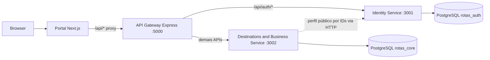

# Arquitetura do Rotas Nordestinas

## Diagnóstico

O projeto tem portal Next.js 15/React 19 e uma API Express separada. Antes da refatoração, os handlers do Next e o backend consultavam diretamente a API e o Auth do Supabase; o backend documentado com Prisma/PostgreSQL ainda não era executável. O domínio inclui identidade/perfil, estados e cidades, pontos turísticos, meios de chegada, atividades, dicas, comentários, favoritos e sugestões de rota. O PDF da disciplina mostra consumidores acessando um API Gateway e domínios de Cidades/Destino, Rotas, Auth e Negócio.

## Proposta implementada



O portal mantém as URLs `/api` que os componentes já consomem. Os handlers Next agora são adaptadores HTTP; o gateway encaminha por domínio. Identidade emite JWT HS256 e os dois serviços validam a assinatura localmente. O serviço de destinos consulta o serviço de identidade em lote para exibir nomes de autores de comentários e criadores de cidade; falha de identidade não impede a leitura pública do conteúdo.

Rotas, cidades e funcionalidades de negócio ficam agrupadas no serviço Destinations: elas compartilham o agregado Cidade e regras relacionadas; dividir cada entidade do diagrama em um processo independente criaria chamadas e operações distribuídas sem benefício demonstrado. Analytics/event bus não foi criado: o código atual não registra eventos nem oferece métricas/notificações e o diagrama da disciplina não exige essa capacidade.

## Fronteiras e dados

| Serviço | Tabelas | Referências externas |
|---|---|---|
| Identity | `users` (credenciais, perfil e função) | Nenhuma |
| Destinations/Business | `states`, `cities`, `tourist_points`, `travel_options`, `activities`, `tips`, `comments`, `favorites`, `route_suggestions` | `user_id`, `criado_por`, `id_admin` são UUIDs opacos; nomes de usuário vêm pela API de Identity |

Há duas instâncias de PostgreSQL no Compose e duas URLs de conexão. Não há FK entre bancos: uma FK cross-service quebraria a autonomia do deploy e não é suportada entre bancos PostgreSQL separados. Dentro do core, cidade referencia estado; os detalhes, comentários, favoritos e sugestão aprovada referenciam cidade. IDs de usuário são validados por JWT e não por leitura de tabela alheia. A exclusão de cidade apaga seus detalhes, comentários e favoritos; a exclusão de perfil não acessa o banco core.

As definições completas, chaves, checks e índices estão em [`infra/db/auth.sql`](../../infra/db/auth.sql) e [`infra/db/core.sql`](../../infra/db/core.sql); os modelos usados pelos serviços estão em `backend/prisma/*.schema`. A migração de dados do esquema anterior está em [`scripts/migrations/001_legacy_core_data.sql`](../../scripts/migrations/001_legacy_core_data.sql). Ela espera um dump das tabelas antigas carregado junto ao esquema core. IDs de utilizador são preservados. Senhas não podem ser recuperadas em texto claro via SQL: usuários migrados precisam de fluxo de redefinição ou importação de hashes compatíveis após validação separada.

## Comunicação e segurança

- Browser → Next → Gateway: HTTP JSON, mesma origem para o browser.
- Gateway → Identity/Destinations: HTTP interno, sem expor portas dos serviços no host.
- JWT tem duração de sete dias. `JWT_SECRET` precisa de pelo menos 32 caracteres e deve ser diferente por ambiente.
- Comentários, favoritos, perfil e sugestões exigem token; o serviço de destinos verifica que o usuário do token corresponde ao ID no pedido.
- `SERVICE_TOKEN` protege consultas internas de identidade.
- Em nuvem, use TLS, redes privadas, secret manager, firewall allowlist, backups e rotação de credenciais.

## Uploads

O antigo Supabase Storage foi removido. O adaptador atual converte imagens de até 4 MB em data URL para manter o fluxo de sugestão funcionando localmente; isso é adequado apenas ao protótipo e pode inflar linhas PostgreSQL. Em produção, configure armazenamento de objetos S3 ou Azure Blob e troque `lib/uploadImage.ts` por upload assinado. Nenhum bucket foi criado.

## Execução local

```bash
cp .env.example .env
docker compose --env-file .env -f infra/docker-compose.yml up --build
```

Portal: `http://localhost:3000`; health agregado do gateway: `http://localhost:5000/health`. Os serviços e bancos ficam na rede privada do Compose. Para desenvolvimento com Next executado no host, rode a infraestrutura pelo Compose e `npm run dev`; `API_GATEWAY_URL=http://localhost:5000` é usado pelo proxy Next.

O banco relacional escolhido é PostgreSQL por compatibilidade com a aplicação anterior, Prisma, JSONB, UUID e disponibilidade gerenciada em ambos provedores. Veja [`docs/infrastructure/README.md`](../infrastructure/README.md) para custo e implantação.
